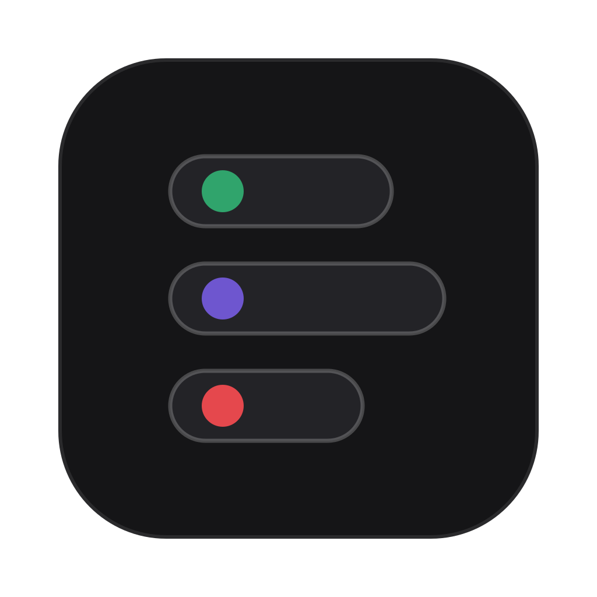
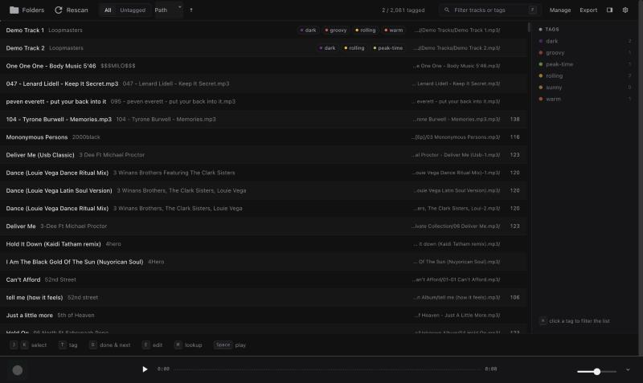

<p align="center">
  
</p>

<h1 align="center">FlowTag</h1>

<p align="center"><b>Keyboard-first tagging for a DJ library.</b><br/>
Play a track, type a tag, hit <code>D</code>, next. 20,000 tracks without touching the mouse.</p>

<p align="center">
  
</p>

---

FlowTag is a personal fork of [OneTagger](https://github.com/Marekkon5/onetagger), rebuilt
around one job: keeping a working DJ collection organized, consistently tagged, and ready
for the booth. The original Quick Tag view (fixed moods, 1–5 energy, preset genres) is
replaced by a freeform, database-backed chip tagger — and that tagger *is* the app.

## How it works

- **SQLite is the source of truth.** Every tag edit lands in a local library database
  instantly (optimistic UI, server echoes). A background **flusher** then writes tags
  into the audio files themselves — a custom `TAGS` field (ID3 `TXXX`, Vorbis comment,
  MP4 freeform) — a few seconds after you stop editing, skipping whatever is playing.
  Kill the app mid-session; the queue resumes on relaunch.
- **One flat tag pool** with per-tag colors (auto-assigned from a 12-hue palette,
  least-used first), optional colored groups, per-tag hotkeys, autocomplete that
  suggests your most-used tags, and merge-on-rename.
- **The library view** is a virtualized list that stays smooth at 20k tracks: zebra
  rows, dense tag chips, colored Camelot keys, BPM/year/path/date-added columns
  (configurable in Settings), text + tag filtering, sorting, multi-select bulk tagging,
  and undo.
- **Rekordbox export** appends your tags as `#hashtags` to each file's comment field —
  searchable in Rekordbox, idempotent on re-export, existing comment text preserved.

## Keyboard

Everything is reachable without the mouse. The letter keys are remappable in Settings.

| Key | Action |
| --- | --- |
| `J` / `K` (or `↑` `↓`) | Previous / next track — `Shift` extends the selection |
| `Space` | Play the selected track / pause (selection alone never starts audio) |
| `T` | Focus the tag input — type, `Enter` adds, new names create tags |
| `D` | **Done**: flush to file, jump to next untagged, autoplay |
| `E` | Edit file metadata in place (title, artist, BPM, key, year, comment) |
| `M` | Online lookup for this track (Beatport, Discogs, MusicBrainz, …) |
| `F` | Focus the filter |
| `←` `→` · `1` `2` `3` `0` | Seek −10s / +30s · jump to 25 / 50 / 75% / start |
| `⌘Z` | Undo the last tag edit |
| *per-tag hotkeys* | Toggle a tag on the selected track (set in Manage tags) |

## The extras

- **Miniplayer** — a frameless always-on-top window (the picture-in-picture button)
  showing the playing track with transport *and* its tag chips: tag from anywhere.
- **OS media keys & Now Playing** — play/pause/next from the keyboard, AirPods, or
  Control Center, with artwork, via [souvlaki](https://github.com/Sinono3/souvlaki).
- **Track inspector** — `E` edits the file's standard tags directly, with the row and
  database kept in sync and self-writes invisible to the scanner.
- **Fast player** — single round-trip start, real seeking, waveforms cached in the DB.

## Build

Requires Rust (stable), Node 18+, and pnpm.

```bash
cd client && pnpm i && pnpm run build && cd ..
cargo build --release
cargo bundle --release   # macOS: target/release/bundle/osx/FlowTag.app
```

`cargo install cargo-bundle` once beforehand for the `.app` bundling. Running the
binary with `--server` starts the backend headless on `http://127.0.0.1:36913`.

## Architecture

| Crate / dir | Role |
| --- | --- |
| `crates/onetagger-db` | Library database: schema & migrations, scan pipeline, tag CRUD, flusher, comment export, track metadata I/O |
| `crates/onetagger-ui` | Axum server + websocket API, embedded client, media-key bridge |
| `crates/onetagger` | Desktop shell: tao/wry webview, miniplayer window, souvlaki media controls |
| `crates/onetagger-tag` ... | Upstream tag read/write, player, lookup platforms (unchanged) |
| `client/` | Vue 3 + Quasar UI — the FlowTag surface in `src/components/flowtag/`, design system in `src/style/flowtag.scss` |

## Credits & license

Built on [OneTagger](https://github.com/Marekkon5/onetagger) by Marekkon5 — the tag
I/O, audio player, and lookup platform integrations are its work. Licensed under
[GPL-3.0](LICENSE), same as upstream. This is a personal tool, tuned to exactly one
workflow; issues and PRs are not expected, but the code is honest.
